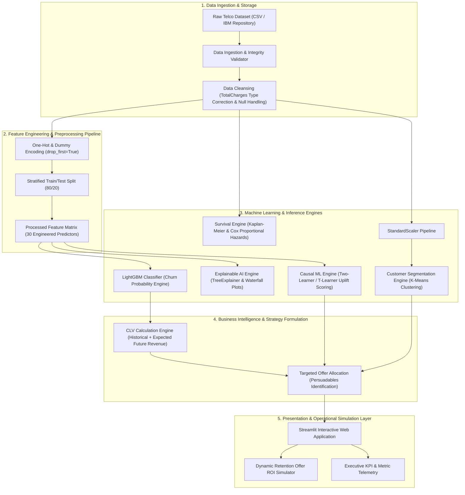
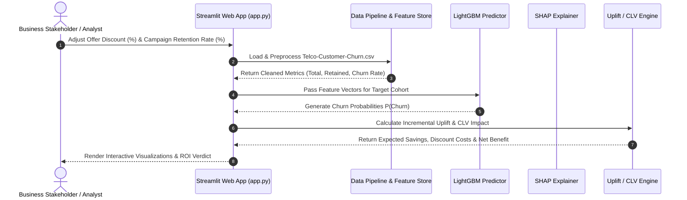
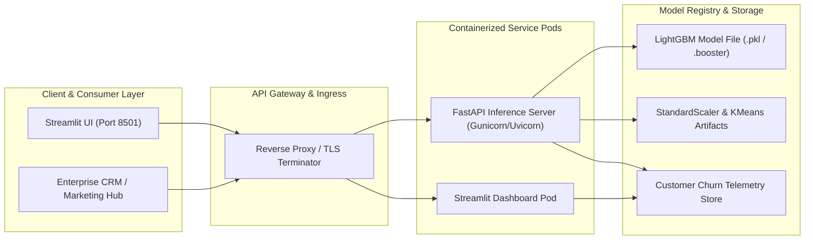

# Customer Churn Intelligence System: Architecture, Data & API Documentation

This document provides architectural blueprints, comprehensive data dictionaries, preprocessing contracts, module interfaces, and enterprise REST API specifications for the **Customer Churn Intelligence & Retention Strategy Platform**.

---

## 1. System Architecture

The platform is designed around a multi-tier decoupled architecture comprising data ingestion, feature transformation, predictive modeling, causal/survival intelligence engines, and business decision layers.

### 1.1 High-Level End-to-End System Architecture



---

### 1.2 Data Flow & Component Interaction Sequence



---

## 2. Data Documentation & Schema

### 2.1 Raw Dataset Specification

The baseline dataset consists of **7,043 customer records** across **21 attributes** captured at customer account level.

| Attribute Name | Raw Data Type | Domain / Allowed Values | Description | Null / Anomaly Treatment |
| :--- | :--- | :--- | :--- | :--- |
| `customerID` | `object` (string) | Format: `^[0-9]{4}-[A-Z]{5}$` | Unique alphanumeric customer account identifier. | Dropped prior to model training. |
| `gender` | `object` (string) | `Female`, `Male` | Customer biological gender. | One-hot encoded (`gender_Male`). |
| `SeniorCitizen` | `int64` | `0` (No), `1` (Yes) | Indicator if customer is aged 65 or older. | Maintained as binary feature. |
| `Partner` | `object` (string) | `Yes`, `No` | Whether customer has a domestic partner. | Binary dummy encoded (`Partner_Yes`). |
| `Dependents` | `object` (string) | `Yes`, `No` | Whether customer lives with dependents. | Binary dummy encoded (`Dependents_Yes`). |
| `tenure` | `int64` | Range: `0` to `72` (months) | Number of months customer has remained subscribed. | Scaled / used directly in models. |
| `PhoneService` | `object` (string) | `Yes`, `No` | Whether customer has active home phone line. | Binary dummy encoded. |
| `MultipleLines` | `object` (string) | `No`, `Yes`, `No phone service` | Status of multiple telephone lines. | Multi-category dummy encoded. |
| `InternetService`| `object` (string) | `DSL`, `Fiber optic`, `No` | Customer high-speed internet subscription type. | Dummy encoded (`Fiber optic`, `No`). |
| `OnlineSecurity` | `object` (string) | `Yes`, `No`, `No internet service` | Subscription to cybersecurity add-on. | Dummy encoded. |
| `OnlineBackup` | `object` (string) | `Yes`, `No`, `No internet service` | Subscription to cloud data backup add-on. | Dummy encoded. |
| `DeviceProtection` | `object` (string) | `Yes`, `No`, `No internet service` | Subscription to hardware insurance coverage. | Dummy encoded. |
| `TechSupport` | `object` (string) | `Yes`, `No`, `No internet service` | Subscription to priority technical support. | Dummy encoded. |
| `StreamingTV` | `object` (string) | `Yes`, `No`, `No internet service` | Subscription to streaming television package. | Dummy encoded. |
| `StreamingMovies`| `object` (string) | `Yes`, `No`, `No internet service` | Subscription to streaming movie library package. | Dummy encoded. |
| `Contract` | `object` (string) | `Month-to-month`, `One year`, `Two year` | Current billing agreement commitment tier. | Dummy encoded (`One year`, `Two year`). |
| `PaperlessBilling` | `object` (string) | `Yes`, `No` | Whether customer opted into digital e-invoicing. | Binary dummy encoded (`PaperlessBilling_Yes`). |
| `PaymentMethod` | `object` (string) | `Electronic check`, `Mailed check`, `Bank transfer (automatic)`, `Credit card (automatic)` | Primary payment remittance channel. | Multi-category dummy encoded. |
| `MonthlyCharges`| `float64` | Range: `18.25` to `118.75` (INR/USD) | Amount billed to customer recurring each month. | Continuous numeric predictor. |
| `TotalCharges` | `object` -> `float64` | Range: `0.00` to `8684.80` | Cumulative lifetime charges billed to customer. | 11 records containing whitespace `" "` converted to `NaN`, then filled with `0.0`. |
| `Churn` (Target) | `object` (string) | `Yes`, `No` | Indicates whether account terminated within last month. | Mapped to binary integer (`No: 0`, `Yes: 1`). |

---

### 2.2 Preprocessing & Feature Engineering Matrix

The raw feature vector is transformed into a **30-dimensional numerical feature matrix** for tree-based estimators and survival regressors:

```text
Raw Features (21 cols)
  │
  ├─> Drop Identifier: ['customerID']
  ├─> Type Cast & Impute: 'TotalCharges' -> pd.to_numeric(..., errors='coerce').fillna(0)
  ├─> Target Encoding: 'Churn' -> {'No': 0, 'Yes': 1}
  └─> Categorical Dummies: pd.get_dummies(..., drop_first=True, dtype=int)
        │
        ▼
Transformed Feature Space (30 Predictors + 1 Target):
 1. SeniorCitizen                          16. OnlineBackup_Yes
 2. tenure                                 17. DeviceProtection_No internet service
 3. MonthlyCharges                         18. DeviceProtection_Yes
 4. TotalCharges                           19. TechSupport_No internet service
 5. gender_Male                            20. TechSupport_Yes
 6. Partner_Yes                            21. StreamingTV_No internet service
 7. Dependents_Yes                         22. StreamingTV_Yes
 8. PhoneService_Yes                       23. StreamingMovies_No internet service
 9. MultipleLines_No phone service         24. StreamingMovies_Yes
10. MultipleLines_Yes                      25. Contract_One year
11. InternetService_Fiber optic            26. Contract_Two year
12. InternetService_No                     27. PaperlessBilling_Yes
13. OnlineSecurity_No internet service     28. PaymentMethod_Credit card (automatic)
14. OnlineSecurity_Yes                     29. PaymentMethod_Electronic check
15. OnlineBackup_No internet service       30. PaymentMethod_Mailed check
```

---

### 2.3 Derived & Analytics Output Schema

| Feature Name | Originating Engine | Data Type | Mathematical Formulation / Definition | Business Purpose |
| :--- | :--- | :--- | :--- | :--- |
| `Historical_Revenue` | CLV Engine | `float64` | $\text{tenure} \times \text{MonthlyCharges}$ | Quantifies realized historical monetization. |
| `Churn_Probability` | LightGBM | `float64` | $P(Y=1 \mid X) \in [0.0, 1.0]$ | Churn risk scoring for threshold gating. |
| `Retention_Probability`| LightGBM | `float64` | $1.0 - \text{Churn\_Probability}$ | Likelihood of organic survival. |
| `Expected_Future_Months`| CLV Engine | `float64` | $12 \times \text{Retention\_Probability}$ | Horizon discount window over next 12 months. |
| `Expected_Future_Revenue`| CLV Engine | `float64` | $\text{MonthlyCharges} \times \text{Expected\_Future\_Months}$ | Forward-looking 12-month expected customer value. |
| `Estimated_CLV` | CLV Engine | `float64` | $\text{Historical\_Revenue} + \text{Expected\_Future\_Revenue}$ | Comprehensive Customer Lifetime Value. |
| `Uplift_Score` | T-Learner Causal ML | `float64` | $\tau(X) = P(Y_{\text{stay}}=1 \mid X, W=1) - P(Y_{\text{stay}}=1 \mid X, W=0)$ | Identifies customers persuaded by offers. |
| `Cluster` | K-Means Engine | `int64` | $\arg\min_{k} \|z(x) - \mu_k\|^2, k \in \{0, 1, 2\}$ | Behavioral customer segmentation tier. |

---

## 3. Internal Python Component & Module API Documentation

### 3.1 Data Ingestion & Sanitization

#### `load_and_clean_data(source_path: str = "Telco-Customer-Churn.csv") -> pd.DataFrame`
* **Description**: Ingests raw CSV from disk or remote HTTP fallback, executes regex type casting for `TotalCharges`, and cleans null values.
* **Input Arguments**:
  * `source_path` (`str`): Filepath to the raw CSV dataset.
* **Return Value**:
  * `pd.DataFrame`: Cleaned Pandas DataFrame of dimensions `(7043, 21)`.
* **Exceptions Handled**: `FileNotFoundError`, `URLError`, `ParserError`.

---

### 3.2 Predictive Modeling Interface (`LightGBMClassifier`)

```python
model = LGBMClassifier(
    n_estimators=100,
    learning_rate=0.05,
    random_state=42,
    verbosity=-1
)
```

* **Target Variable**: `Churn` (Binary: 0 for Stayed, 1 for Churned).
* **Train / Test Protocol**: 80% Train ($N=5,634$), 20% Test ($N=1,409$), Stratified by target distribution.
* **Output Predictions**:
  * `predict(X: np.ndarray) -> np.ndarray[int]`: Hard class prediction $[0, 1]$.
  * `predict_proba(X: np.ndarray) -> np.ndarray[float, float]`: Class posterior probability $[P(Y=0), P(Y=1)]$.

---

### 3.3 Explainability Interface (`SHAP TreeExplainer`)

* **Explainer Class**: `shap.TreeExplainer(model)`
* **Input**: Feature tensor $X \in \mathbb{R}^{N \times 30}$.
* **Outputs**:
  * Global Summary: `shap.summary_plot(shap_values, X_test)`
  * Local Instance Waterfall: `shap.plots.waterfall(shap.Explanation(...))`
* **Mathematical Contract**:
  $$\sum_{j=1}^{M} \phi_j(x) = f(x) - E[f(x)]$$
  Where $\phi_j(x)$ represents the marginal additive contribution of feature $j$ to the log-odds output.

---

### 3.4 Causal Uplift Engine (`NativeTLearner`)

```python
class NativeTLearner:
    """Two-Learner (T-Learner) for Conditional Average Treatment Effect (CATE) estimation."""
    def fit(self, X: pd.DataFrame, treatment: pd.Series, y: pd.Series) -> "NativeTLearner":
        """Fits separate LightGBM models for control (treatment=0) and treated (treatment=1)."""
        ...
    def predict(self, X: pd.DataFrame) -> np.ndarray:
        """Returns Uplift Score: P(Stayed | Treated) - P(Stayed | Control)."""
        ...
```

* **Target**: Customer retention ($1 - \text{Churn}$).
* **Treatment**: Binary intervention indicator ($W \in \{0, 1\}$).
* **Optimization Goal**: Target customers with $\tau(X) > 0$ (Persuadables), while withholding costly promotions from indifferent customers ($\tau(X) \approx 0$).

---

### 3.5 Customer Lifetime Value (CLV) Engine

* **Formula**:
  $$\text{CLV} = (\text{MonthlyCharges} \times \text{tenure}) + \left(\text{MonthlyCharges} \times 12 \times [1 - P(\text{Churn} \mid X)]\right)$$
* **Horizon**: 12-month expected future projection window.
* **Outputs**: Tiered ranking of customer accounts by revenue impact.

---

### 3.6 Customer Segmentation Engine

* **Pipeline**:
  1. Feature subspace: `["tenure", "MonthlyCharges", "TotalCharges"]`
  2. Normalization: `sklearn.preprocessing.StandardScaler`
  3. Clustering: `sklearn.cluster.KMeans(n_clusters=3, random_state=42, n_init=10)`
* **Cluster Profiles**:
  * **Cluster 0 (New/Moderate-Spend Starters)**: Low tenure, moderate charges, elevated churn risk.
  * **Cluster 1 (Long-Term High-Spend Loyalists)**: High tenure, premium tier subscriptions, minimal churn.
  * **Cluster 2 (Low-Cost Basic Users)**: Mixed tenure, minimum contract options, low monthly spend.

---

### 3.7 Retention Offer ROI Simulation Engine (`app.py`)

* **Input Parameters**:
  * `discount` ($\delta \in [0.0, 0.50]$): Discount percentage offered on monthly plan.
  * `assumed_retention_rate` ($\alpha \in [0.05, 0.80]$): Expected win-back success rate.
  * `months` ($M = 12$): Campaign duration horizon.
* **Formulas**:
  $$\text{Customers Retained} = N_{\text{churn}} \times \alpha$$
  $$\text{Expected Gross Savings} = \text{Customers Retained} \times \overline{\text{MonthlyCharges}} \times M$$
  $$\text{Discount Cost} = \text{Customers Retained} \times \overline{\text{MonthlyCharges}} \times \delta \times M$$
  $$\text{Net Benefit} = \text{Expected Gross Savings} - \text{Discount Cost}$$

---

## 4. Enterprise REST API Blueprint (OpenAPI / Microservice Spec)

For production deployment as a high-throughput microservice (e.g. FastAPI / Docker), the system exposes the following REST interface:

### 4.1 OpenAPI Endpoint Directory

```text
POST /api/v1/predict/churn      - Real-time churn probability scoring
POST /api/v1/explain/shap       - Local SHAP waterfall explanation
POST /api/v1/uplift/score       - Uplift / treatment responsiveness scoring
POST /api/v1/clv/calculate      - Customer Lifetime Value estimation
POST /api/v1/segment/cluster    - Behavioral cluster assignment
POST /api/v1/simulate/campaign  - Retention offer ROI simulation
GET  /api/v1/health             - Service health & model registry telemetry
```

---

### 4.2 Endpoint Specifications

#### 1. Real-Time Churn Prediction
* **Route**: `POST /api/v1/predict/churn`
* **Request Payload**:
```json
{
  "customerID": "7590-VHVEG",
  "gender": "Female",
  "SeniorCitizen": 0,
  "Partner": "Yes",
  "Dependents": "No",
  "tenure": 1,
  "PhoneService": "No",
  "MultipleLines": "No phone service",
  "InternetService": "DSL",
  "OnlineSecurity": "No",
  "OnlineBackup": "Yes",
  "DeviceProtection": "No",
  "TechSupport": "No",
  "StreamingTV": "No",
  "StreamingMovies": "No",
  "Contract": "Month-to-month",
  "PaperlessBilling": "Yes",
  "PaymentMethod": "Electronic check",
  "MonthlyCharges": 29.85,
  "TotalCharges": 29.85
}
```

* **Response Payload (200 OK)**:
```json
{
  "customerID": "7590-VHVEG",
  "churn_prediction": 1,
  "churn_probability": 0.6842,
  "risk_category": "HIGH",
  "actionable_flags": [
    "Month-to-month contract",
    "Electronic check payment",
    "Absence of TechSupport"
  ],
  "latency_ms": 4.12
}
```

---

#### 2. Local SHAP Attribution
* **Route**: `POST /api/v1/explain/shap`
* **Request Payload**:
```json
{
  "customerID": "7590-VHVEG",
  "max_features": 5
}
```

* **Response Payload (200 OK)**:
```json
{
  "customerID": "7590-VHVEG",
  "base_value": -1.1428,
  "prediction_log_odds": 0.7731,
  "contributions": [
    {"feature": "tenure", "value": 1.0, "shap_value": 0.8421},
    {"feature": "Contract_Two year", "value": 0.0, "shap_value": 0.4512},
    {"feature": "InternetService_Fiber optic", "value": 0.0, "shap_value": -0.2104},
    {"feature": "PaymentMethod_Electronic check", "value": 1.0, "shap_value": 0.1852},
    {"feature": "TechSupport_Yes", "value": 0.0, "shap_value": 0.1420}
  ]
}
```

---

#### 3. Retention Campaign ROI Simulator
* **Route**: `POST /api/v1/simulate/campaign`
* **Request Payload**:
```json
{
  "target_cohort": "High_Risk_Churn",
  "discount_percentage": 15.0,
  "assumed_retention_rate": 0.35,
  "campaign_horizon_months": 12
}
```

* **Response Payload (200 OK)**:
```json
{
  "target_customer_count": 1869,
  "expected_retained_customers": 654,
  "average_monthly_charge": 74.44,
  "gross_revenue_retained": 584200.64,
  "estimated_discount_cost": 87630.10,
  "net_financial_benefit": 496570.54,
  "roi_percentage": 566.67,
  "recommendation": "PROCEED: Highly profitable campaign with net positive revenue."
}
```

---

## 5. Operational Deployment & Topology



---

## 6. Summary of Architectural Decisions

1. **LightGBM as Primary Classifier**: Selected over Random Forest / XGBoost for superior tree histogram binning speed, native categorical handling, and lower memory footprint.
2. **TreeSHAP for Deterministic Explainability**: Provides exact polynomial-time Shapley values satisfying local accuracy and consistency guarantees.
3. **Causal T-Learner for Uplift**: Decouples treatment response modeling from standard churn classification to prevent subsidizing customers who would not have churned anyway.
4. **Streamlit for Interactive Business Translation**: Bridging machine learning output with financial P&L metrics via real-time ROI simulation.
